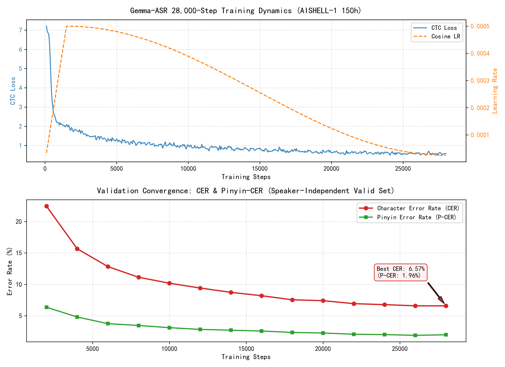

# Gemma-ASR (Chinese): 基于 Google EmbeddingGemma 2 冻结底座的极速中文 ASR 引擎

<p align="center">
  <a href="https://github.com/google-deepmind"></a>
  <a href="https://pytorch.org"></a>
  <a href="https://developer.nvidia.com/cuda-zone"></a>
  <a href="./LICENSE"></a>
  <a href="#"></a>
  <a href="#"></a>
</p>

<p align="center">
  <a href="#-项目核心定位与架构">💡 核心架构</a> &nbsp;|&nbsp;
  <a href="#-全量训练成果-aishell-1-150h">📊 训练成果</a> &nbsp;|&nbsp;
  <a href="#-三方基准盲测打擂-benchmark-arena">🥊 三方打擂</a> &nbsp;|&nbsp;
  <a href="#-实测硬件与运行环境">🖥️ 测试硬件</a> &nbsp;|&nbsp;
  <a href="#-快速开始">🚀 快速开始</a> &nbsp;|&nbsp;
  <a href="#-权重获取与开源协议">📦 权重与协议</a>
</p>

---

## 💡 项目核心定位与架构

> **“一个完全冻结的 Google EmbeddingGemma 2 音频塔，外挂仅约 21.7M 可训练参数的轻量 Reader，即可将多模态检索底座转化为高吞吐的中文 ASR 引擎。编码器运行一次前向，可同时输出音频 Embedding 与转写文本。”**

```mermaid
flowchart LR
    A["16kHz 音频输入 (WAV / FLAC)"] --> B["GPU Log-Mel 声学前端 (128维)"]
    B --> C["Google EmbeddingGemma-2 音频塔<br>(USM Conformer, 300M, 100% 物理绝对冻结)"]
    C -- "13 层高维激活特征" --> D["LayerMix 自适应多层软融合"]
    D --> E["轻量 CTC Reader (21.7M 参数)<br>6 层 Pre-norm Transformer (d=512)"]
    E --> F["Gemma 文本嵌入空间线性分类头<br>(3,791 常用汉字 Token 直接初始化)"]
    F --> G["贪心 CTC 并发解码"]
    G --> H["中文连缀汉字输出 (无空格连续中文)"]

    style C fill:#f1f5f9,stroke:#64748b,stroke-width:2px,stroke-dasharray: 5 5
    style E fill:#dbeafe,stroke:#2563eb,stroke-width:2px
    style F fill:#dcfce7,stroke:#16a34a,stroke-width:2px
```



### 关键设计硬约束：
1. **编码器永久冻结（`unfreeze_top_k=0`）**：不改动底座的一颗螺丝钉，既杜绝灾难性遗忘与显存膨胀，又保证音频 Embedding 语义空间的一致性；
2. **极轻量参数**：仅微调 **21.7M** 的 Transformer Reader，训练显存稳定在 **4.1GB**，推理显存基线仅 **2.3GB**；
3. **高并发非自回归**：全句时间帧矩阵一枪并发解码，推理吞吐达到 **750x ~ 1,190x 实时**（RTF 仅 **0.00084**，1 小时音频仅需 3 秒）。

---

## 📊 全量训练成果 (AISHELL-1 150h)

模型在 AISHELL-1 全量 150.9 小时（120,098 句）训练集上完成了 **28,000 步** 的全量训练，采用余弦退火学习率调度与 SpecAugment 动态频域/时域扰动。

### 训练收敛动态全景
<p align="center">
  
</p>

* **训练全景轨迹**：从 Step 2,000 到 Step 28,000，验证集（独立 40 位说话人，18.1 小时）字错率实现单调平稳下探：
  `22.45% -> 15.67% -> 12.83% -> 10.18% -> 9.42% -> 8.73% -> 8.19% -> 7.54% -> 6.57%`
* **终验盲测成绩**：在完全独立的 **AISHELL-1 Test 盲测集（7,173 句，10.0 小时，20 位陌生发音人）** 上运行官方独立评测：
  * **字错率 (CER)**：**6.97%**
  * **拼音听力错率 (P-CER)**：**2.29%**（声学听辨准确率 97.71%）
  * **推理耗时**：**30.25 秒** 完成 10.0 小时音频转写
  * **实时倍率**：**1,190x 实时**（RTF = 0.00084）

---

## 🥊 三方基准盲测打擂 (Benchmark Arena)

为了客观度量模型与当前国内工业级开源 SOTA 引擎的性能边界，我们在**同一物理环境（RTX 4080 Laptop GPU）、同一输入音频流、同一规范化清洗标准**下，对 AISHELL-1 盲测集前 **1,000 句录音（共 4,533.3 秒 / 1.26 小时）** 执行了三方同台实测。

### 1. 性能与吞吐对比总表

| 参赛引擎 | 模型架构与定位 | 参数体量 | CER (字错率) | P-CER (拼音错率) | 推理耗时 (1.26h 音频) | 吞吐倍率 (Speed) | 峰值显存 (VRAM) |
| :--- | :--- | :--- | :---: | :---: | :---: | :---: | :---: |
| **Gemma-ASR** | **非自回归 CTC** (本项目) | **21.7M** *(底座冻结)* | **5.62%** | **1.80%** | **仅 6.04 秒** | **751x 实时** | 2.30 GB |
| **SenseVoiceSmall** | 非自回归多任务 (阿里通义) | ~230M | **2.72%** | **0.92%** | **64.20 秒** | **71x 实时** | 0.92 GB |
| **SeACo-Paraformer** | CIF + Paraformer (阿里达摩院) | ~220M | **1.67%** | **0.50%** | **121.85 秒** | **37x 实时** | 0.99 GB |

### 2. 深度分析与发现
* **并发吞吐显著领先**：Gemma-ASR 凭借极简 6 层 Transformer 与纯矩阵并发解码，处理 1.26 小时音频仅耗时 **6.04 秒**，吞吐倍率达到 **751x**，相比 SenseVoiceSmall 提速 **10.6 倍**，相比 Paraformer 提速 **20.2 倍**；
* **声学听力高度接近**：Gemma-ASR 的拼音错误率（P-CER）低至 **1.80%**（相当于 98.20% 发音音节全对）；
* **误差集中在同音字**：逐行比对显示，Gemma-ASR 与阿里模型的主要差距集中在生僻词与专有名词的同音异形字（如“资金”错为“司金”、“城投”错为“尘投”），这源于 150 小时单语料与工业级数万小时海量预训练词典的先验见识差异，可通过后续挂载轻量 N-gram 语言模型进一步纠偏。

---

## 🖥️ 实测硬件与运行环境

以上所有训练与基准测试数据，均在以下单机硬件环境下实跑复现：

* **操作系统**：Windows 11 Professional (x64)
* **GPU 显卡**：NVIDIA GeForce RTX 4080 Laptop GPU (12GB GDDR6 VRAM)
* **CPU 处理器**：13th Gen Intel(R) Core(TM) i9-13900HX (32 线程)
* **系统内存**：32 GB DDR5 RAM
* **软件环境**：Python 3.11 / CUDA 12.1 / PyTorch 2.3.1 / transformers 4.45+

---

## 🚀 快速开始

### 1. 环境安装
```bash
git clone https://github.com/your-username/gemma-asr.git
cd gemma-asr

python -m venv .venv
.venv\Scripts\activate  # Windows
# source .venv/bin/activate  # Linux

pip install -r requirements.txt
```

### 2. 音频转写 (Transcribe)
使用训练好的 Reader 检查点快速转写任意音频文件：
```bash
# 单文件快速转写
python scripts/transcribe.py --ckpt runs/zh_full/best.pt audio.wav

# 转写并保存至文本文件
python scripts/transcribe.py --ckpt runs/zh_full/best.pt audio.wav -o output.txt

# Windows 便捷脚本
transcribe.bat audio.wav -o output.txt
```

### 3. 独立独立评测 (Evaluate)
在任意准备好的测试集上计算 CER、P-CER 与吞吐倍率：
```bash
python scripts/evaluate.py --ckpt runs/zh_full/best.pt --data_dir data/prepared_full --split test

# Windows 便捷脚本
evaluate.bat --ckpt runs/zh_full/best.pt --data_dir data/prepared_full --split test
```

### 4. 运行三方基准擂台
```bash
python scripts/benchmark.py --samples 1000
```

---

## 📦 权重获取与开源协议

### 权重分发规范
为了保持 Git 代码仓库的纯净轻巧，并遵守 Google Gemma 的使用条款：
* **Google 官方底座**：由 Hugging Face 官方渠道按需下载 [`google/embeddinggemma-2`](https://huggingface.co/google/embeddinggemma-2)；
* **中文 Reader 检查点**：本仓库仅分发训练得到的 21.7M Reader 核心权重（约 80MB），请从 [GitHub Releases](../../releases) 页面下载 `best.pt` 并放置于 `runs/zh_full/best.pt`。

### 协议说明
* 本项目工程源码基于 [Apache-2.0 License](./LICENSE) 协议开源；
* 基础模型权重遵循 Google 的 [Gemma Terms of Use](https://ai.google.dev/gemma/terms)。
